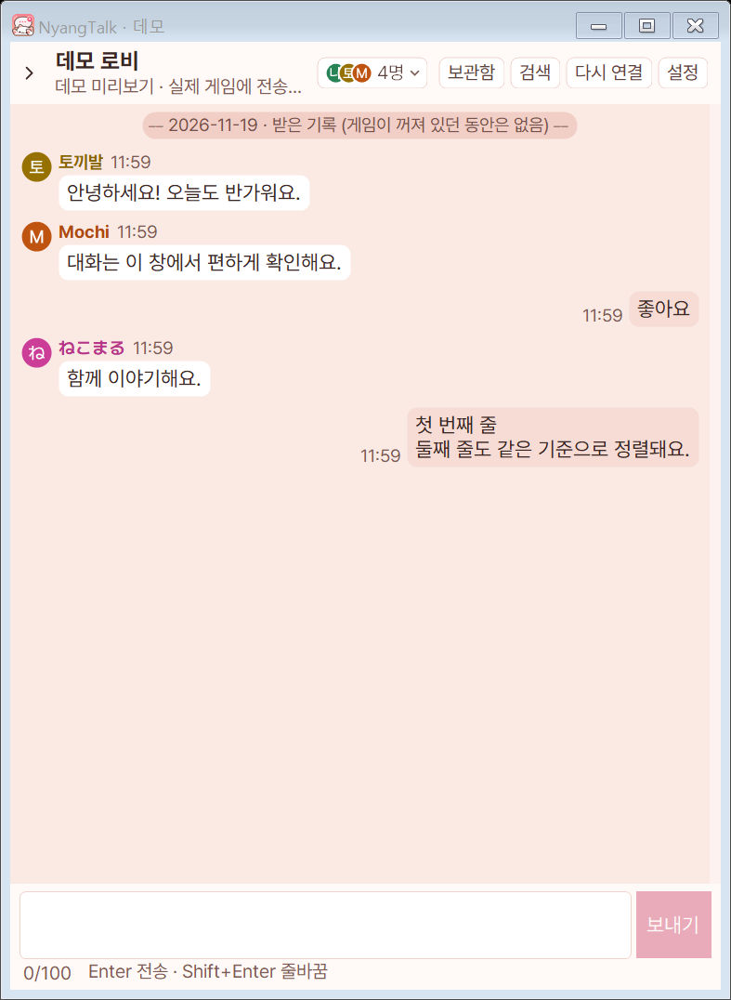
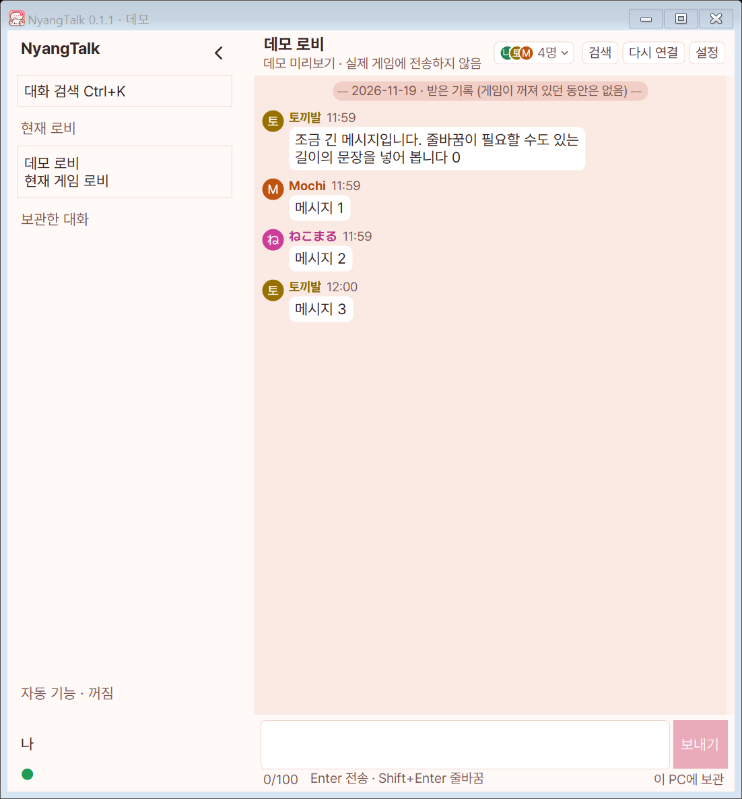
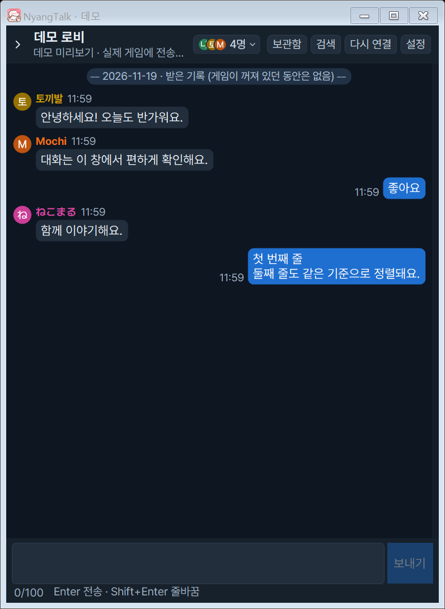
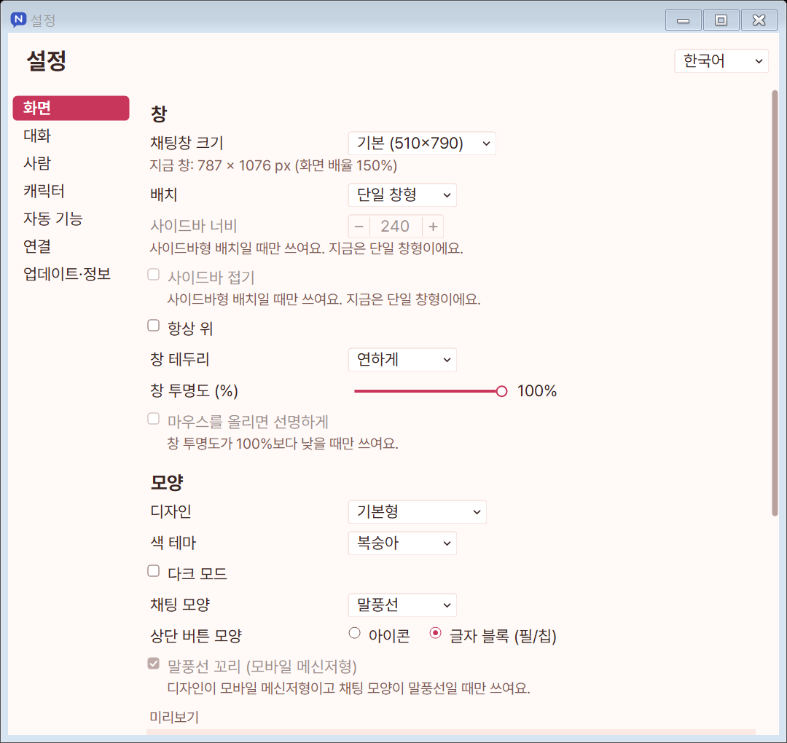
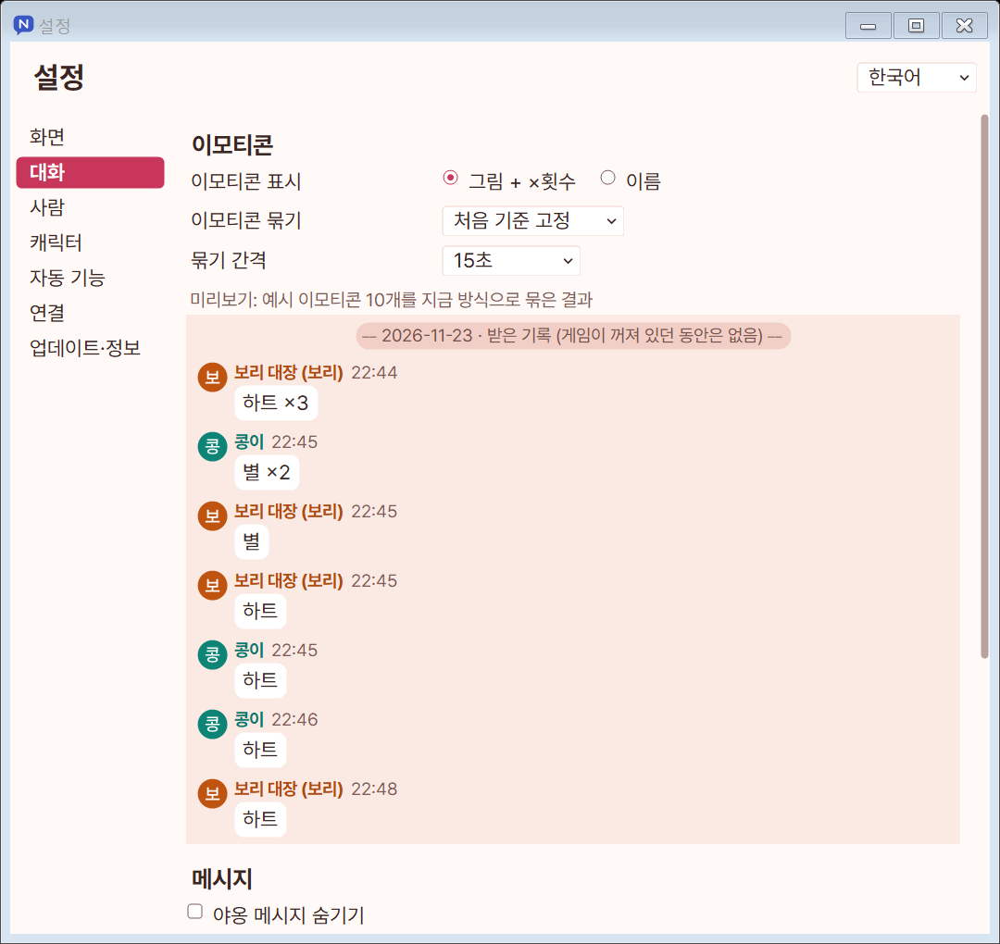

# NyangTalk

Steam 게임 Bongo Cat의 로비 대화를 별도 창에서 읽고 보내는 Windows 메신저입니다. 현재 버전은 **0.1.7**입니다.

[최신 버전 다운로드](https://github.com/Alexandros509/NyangTalk/releases/latest)

## 주요 기능

- 로비 대화 송수신, 대화 기록·검색, 전송 실패 표시와 재전송
- 참가자 목록, 별명, 사람별 색상, 알림
- 밝게·어둡게 모드와 6가지 테마, 글꼴·글자 크기 설정
- 게임 연결 상태 확인, 연결 구성요소 설치·복구
- 선택형 상자 자동 열기, 서명 검증을 거치는 앱 업데이트

## 화면

아래 화면은 별도 데모 데이터로 생성했습니다. 실제 게임에 전송하지 않습니다.

[참여자 패널 예시](design-system/images/participants-panel.png)
[이모티콘 미리보기](design-system/images/settings-emote-preview.png) ·
[캐릭터: 모자 포함](design-system/images/settings-character-hat.png) ·
[캐릭터: 얼굴만](design-system/images/settings-character-face.png)

## 설치와 실행

1. 릴리스에서 **NyangTalk-0.1.7.exe**를 내려받습니다.
2. 실행 후 언어와 게임 폴더를 선택합니다.
3. 게임을 종료한 상태에서 연결 구성요소를 설치하고 게임을 다시 실행합니다.
4. 게임 로비에 들어가면 대화 창에서 연결 상태를 확인할 수 있습니다.

Windows 10/11 x64와 .NET Framework 4.8이 필요합니다. 실행 파일에는 연결 구성요소와 글꼴이 포함되어 있습니다.
Windows 코드 서명 인증서는 적용하지 않았습니다. 앱 업데이트의 ECDSA 서명은 다운로드 검증에 사용합니다.

### 기존 BepInEx 또는 채팅 모드를 사용했다면

1. **게임과 기존 채팅 프로그램을 종료**합니다.
2. NyangTalk을 실행하고 **설정 → 연결**에서 게임 폴더를 확인합니다.
3. **이전 모드 옮기고 새로 설치**를 누르고 화면 안내에 따라 진행합니다.
4. 설치가 끝나면 게임을 실행하고 로비에 들어갑니다.

기존 BepInEx와 모드 파일은 게임 폴더 밖에 별도 보관됩니다.
**이전 모드 되돌리기**로 복원할 수 있습니다. 다른 BepInEx 모드도 함께 보관되어 잠시 비활성화됩니다.
이미 NyangTalk만 사용 중이라면 **연결 다시 설치**를 사용합니다.

0.1.4의 게임 글자·파일 공유·본인 말풍선 수정은 연결 구성요소 0.1.4 설치 후 **게임을 다시 시작해야** 적용됩니다.

**Enter**는 전송, **Shift+Enter**는 줄바꿈입니다. 대화는 일반 텍스트이며 HTML 태그는 문자 그대로 표시합니다.
기본 글꼴은 Pretendard 11pt입니다. 글자 크기는 8–16pt 범위에서 조절할 수 있습니다.
캐릭터 크기는 **작게 44px · 보통 60px · 크게 80px**입니다. 컴팩트 표시는 간격을 줄이기 위해 20px로 고정됩니다.

전송 요청이 접수되면 입력창은 즉시 비워집니다. 거절되거나 실패한 글 아래의 **원문 되살리기**로 다시 편집할 수 있습니다.
새로 쓰던 글이 있으면 교체 여부를 먼저 확인하며, 게임의 입력 규칙·필터 거절은 일반 전송 오류와 구분합니다.

**설정 → 연결 → 바로가기 만들기**에서 시작 메뉴·바탕화면을 각각 선택해 만들 수 있습니다. 선택 전에는 생성하지 않습니다.
설정창은 메신저 옆의 공간을 우선 사용하고, 자리가 부족하면 화면 안에서 겹침을 줄이는 위치에 열립니다.
0.1.5–0.1.7의 앱 기능에는 게임 재시작이 필요하지 않으며 연결 구성요소는 0.1.4를 계속 사용합니다.

대화·별명·설정은 기본적으로 %LOCALAPPDATA%\NyangTalk에 보관합니다. 데모는 별도 데이터 폴더를 사용합니다.

연결 구성요소는 BepInEx 5 기반 게임 모드입니다. 자동 기능은 기본적으로 꺼져 있으며 설정에서 선택할 수 있습니다.
게임 업데이트 후 연결이 끊기면 [설치·복구 안내](docs/manual-checklist.md)를 확인해 주세요.

## 개발

.NET Framework 4.8의 C# 컴파일러로 빌드합니다.

~~~powershell
powershell -NoProfile -ExecutionPolicy Bypass -File build.ps1
powershell -NoProfile -ExecutionPolicy Bypass -File build.ps1 -Release
.\build\NyangTalk.exe --demo
~~~

첫 명령은 계층별 빌드와 자동 검사를 실행합니다. 두 번째 명령은 단일 실행 파일을 만듭니다.
게임 플러그인을 빌드하려면 설치된 게임의 관리형 DLL이 필요합니다. 게임 DLL은 컴파일 참조로만 사용합니다.

- [기술·구조 안내](docs/decisions.md)
- [검증 범위와 결과](docs/verification.md), [자동 검사 결과](docs/acceptance-status.md)
- [알려진 제한](docs/remaining.md), [변경 기록](CHANGELOG.md)
- [디자인 시스템](design-system/README.md)
- [제3자 고지](THIRD-PARTY-NOTICES.md), [배포 구성요소 출처](third_party/SOURCES.md)

NyangTalk은 Irox Games의 공식 제품이 아니며 게임사가 제작·승인·후원하지 않았습니다.
Bongo Cat이라는 이름은 함께 사용하는 게임을 식별하기 위해 표기합니다.

NyangTalk 자체 코드는 [MIT](LICENSE)입니다. 포함된 라이브러리와 글꼴에는 각자의 라이선스가 적용됩니다.
